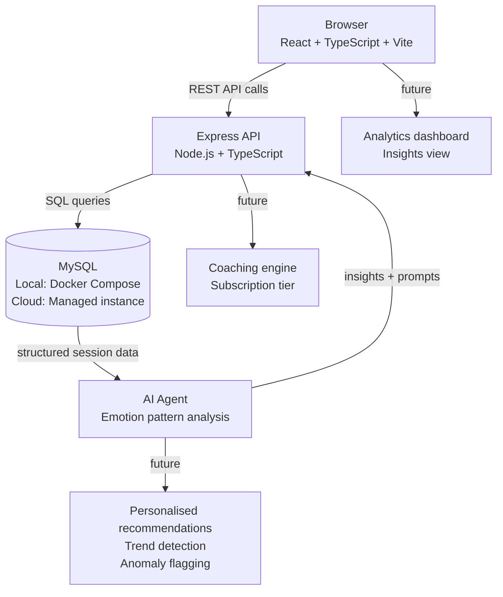
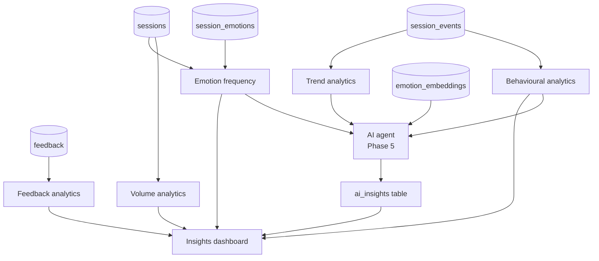
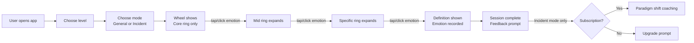

# Feelings Wheel Webapp — Project Plan
**Date:** 2026-11-03
**Status:** Planning — awaiting DBT workbook feelings data

---

## What we are building

An interactive web application built around the Feelings Wheel concept. Users select their emotional state by drilling down through three rings of the wheel (core → middle → specific). The app records anonymous sessions, provides definitions for each feeling on hover/click, supports three user levels (child, developing adult, advanced), and gives users the choice between a general emotional hygiene exercise or processing a specific incident. Session data is stored in a local MySQL database and will feed analytics and insights.

A subscription feature (phase 3+) will offer a coaching flow — a guided paradigm shift to help users reframe their thoughts after identifying a feeling tied to a specific incident.

---

## Architecture overview

```
Browser (React + TypeScript)
        │
        ▼
Express API (Node.js + TypeScript)
        │
        ▼
MySQL Database (Docker local / managed cloud)
```



---

## Tech stack

| Layer | Choice | Reason |
|---|---|---|
| Frontend | React + TypeScript + Vite | Fast dev server, strong typing, component model suits wheel drill-down |
| Styling | Tailwind CSS | Utility-first, easy to theme per difficulty level |
| Backend | Node.js + Express + TypeScript | Lightweight, familiar, easy to containerise |
| Database | MySQL 8 | Relational suits structured session + emotion data; managed versions available on all target clouds |
| Local dev DB | Docker Compose (MySQL container) | No local install needed, portable, mirrors cloud exactly |
| ORM | Prisma | Type-safe schema, auto-generates migrations, works well with MySQL |
| API contract | REST (JSON) | Simple, sufficient for this scope |
| AI layer | watsonx.ai or OpenAI API (TBD) | Plugs into session + analytics data; model choice deferred to Phase 5 |

---

## Deployment targets (to be decided — cost comparison required)

| Platform | Notes |
|---|---|
| IBM Cloud Code Engine | Serverless containers, pay-per-use, integrates with IBM Cloud Databases for MySQL |
| Azure Container Apps | Similar serverless container model, Azure Database for MySQL available |
| Vercel | Excellent for frontend; backend needs Vercel Functions or a separate container — MySQL handled via PlanetScale or Clever Cloud |

> **Decision deferred** — will compare costs once the MVP is scoped and container sizes are known.

---

## Database design

All session data is anonymous. No names, emails, or identifying information are stored.

### Tables

#### `sessions`
| Column | Type | Notes |
|---|---|---|
| id | UUID | Primary key |
| created_at | DATETIME | Session start time |
| level | ENUM('child','adult','advanced') | Difficulty level chosen |
| mode | ENUM('general','incident') | Exercise mode |
| overriding_emotion | VARCHAR(100) | The top-level emotion selected |
| completed | BOOLEAN | Whether user finished the exercise |
| feedback_rating | TINYINT NULL | 1–5 star rating (optional) |
| feedback_text | TEXT NULL | Free-text feedback (optional) |

#### `session_emotions`
| Column | Type | Notes |
|---|---|---|
| id | UUID | Primary key |
| session_id | UUID | FK → sessions.id |
| ring | ENUM('core','mid','specific') | Which ring the selection was from |
| emotion_key | VARCHAR(100) | Slug identifier for the emotion |
| selected_at | DATETIME | Timestamp of selection |
| dwell_ms | INT NULL | Time spent on this emotion before selecting (ms) |

#### `emotions`
| Column | Type | Notes |
|---|---|---|
| key | VARCHAR(100) | Primary key (slug, e.g. 'angry', 'frustrated') |
| label | VARCHAR(100) | Display name |
| definition | TEXT | Hover/click definition |
| parent_key | VARCHAR(100) NULL | FK → emotions.key (for mid and specific ring emotions) |
| ring | ENUM('core','mid','specific') | Which ring this emotion lives on |
| sector_colour | VARCHAR(7) | Hex colour for this sector |
| level_min | ENUM('child','adult','advanced') | Minimum level at which this emotion appears |
| source | VARCHAR(100) | e.g. 'name-it-to-tame-it', 'dbt-workbook' |

#### `feedback`
| Column | Type | Notes |
|---|---|---|
| id | UUID | Primary key |
| session_id | UUID NULL | FK → sessions.id (nullable — allow standalone feedback) |
| submitted_at | DATETIME | |
| rating | TINYINT NULL | 1–5 |
| comment | TEXT NULL | Free text |
| page_context | VARCHAR(100) NULL | Which screen they were on when they submitted |

#### `session_events` *(AI-ready event log)*
| Column | Type | Notes |
|---|---|---|
| id | UUID | Primary key |
| session_id | UUID | FK → sessions.id |
| event_type | VARCHAR(100) | e.g. 'wheel_start', 'ring_expanded', 'emotion_hovered', 'emotion_selected', 'definition_viewed', 'coaching_started', 'session_abandoned' |
| event_data | JSON NULL | Arbitrary payload — emotion key, ring, dwell time, UI state. JSON so schema can evolve without migrations |
| occurred_at | DATETIME | |

> **Why this table exists:** A flat `session_emotions` table tells you what was selected. This event log tells you the full behavioural story — hesitations, backtracks, hovers, time on each ring. This is the raw material an AI agent needs to detect patterns beyond simple counts.

#### `ai_insights` *(future — Phase 5)*
| Column | Type | Notes |
|---|---|---|
| id | UUID | Primary key |
| generated_at | DATETIME | When the insight was produced |
| scope | ENUM('global','session','cohort') | What data the insight is about |
| session_id | UUID NULL | FK → sessions.id (if scope = 'session') |
| insight_type | VARCHAR(100) | e.g. 'emotion_cluster', 'trend', 'anomaly', 'reframe_suggestion' |
| insight_text | TEXT | Human-readable insight |
| model_id | VARCHAR(100) NULL | Which AI model produced this |
| confidence | DECIMAL(4,3) NULL | 0.000–1.000 |
| raw_output | JSON NULL | Full model response for auditability |

> **Why now:** The table is created in Phase 1 migrations even though it is not populated until Phase 5. This means the schema is stable and no future migration needs to touch foreign key relationships.

#### `emotion_embeddings` *(future — Phase 5)*
| Column | Type | Notes |
|---|---|---|
| emotion_key | VARCHAR(100) | FK → emotions.key |
| model_id | VARCHAR(100) | Which embedding model was used |
| embedding | JSON | Vector as JSON array (until a native vector column type is supported) |
| created_at | DATETIME | |

> **Why this table exists:** Storing vector embeddings of emotion definitions enables semantic search and similarity matching — e.g. "find sessions where the user felt something close to shame even if they didn't select that word". Required for the AI recommendation and pattern detection features.

#### `emotion_dimensions` *(DBT integration)*
| Column | Type | Notes |
|---|---|---|
| id | UUID | Primary key |
| emotion_key | VARCHAR(100) | FK → emotions.key |
| dimension | ENUM | 'synonyms', 'prompting_event', 'interpretation', 'biological_change', 'expression_action', 'aftereffect', 'opposite_action', 'justified_when', 'coping_strategy', 'child_language' |
| content | TEXT | The actual text for this dimension bullet point |
| level_min | ENUM('child','adult','advanced') | Minimum level at which this content is shown |
| source | VARCHAR(100) | e.g. 'dbt-handout-6', 'dbt-handout-11' |
| display_order | SMALLINT | Order within the dimension group |

> **Why this table exists:** Stores the 6 DBT dimensions per emotion (prompting events, interpretations, biological changes, expressions/actions, aftereffects, opposite actions) as individual queryable rows. Normalised so AI can query specific dimensions directly and new frameworks (CBT, ACT) can be added without schema changes.

#### `coping_suggestions`
| Column | Type | Notes |
|---|---|---|
| id | UUID | Primary key |
| emotion_key | VARCHAR(100) NULL | FK → emotions.key. NULL = universal suggestion |
| suggestion | TEXT | The suggestion text |
| category | ENUM | 'breathing', 'grounding', 'opposite_action', 'pleasant_event', 'please_skill', 'mindfulness', 'crisis', 'values_reflection' |
| level_min | ENUM('child','adult','advanced') | |
| source | VARCHAR(100) | |

#### `session_reflections` *(Check the Facts + coaching flow)*
| Column | Type | Notes |
|---|---|---|
| id | UUID | Primary key |
| session_id | UUID | FK → sessions.id |
| emotion_key | VARCHAR(100) | FK → emotions.key |
| emotion_fits_facts | ENUM('yes','no','unsure') NULL | Did the user say this emotion fits? |
| action_urge | TEXT NULL | Free text: "I want to withdraw" |
| opposite_taken | BOOLEAN NULL | Did they commit to opposite action? |
| reframe_text | TEXT NULL | User's own reframe (free text) |
| commitment_text | TEXT NULL | "One thing I will do" |
| intensity_before | TINYINT NULL | 1–10 intensity at selection |
| intensity_after | TINYINT NULL | 1–10 intensity at end of session |
| created_at | DATETIME | |

---

## Analytics — possible directions

The session data model supports a wide range of analytics. These are not all in scope for Phase 2, but the data will be there from day one.

### Volume and usage analytics
- Sessions per day / week / month
- Completion rate (started vs completed)
- Abandonment point (which ring do people drop out at?)
- Most-used difficulty level
- Split between general hygiene vs incident mode

### Emotion frequency analytics
- Most commonly selected core emotions (global)
- Most commonly selected specific emotions per core emotion
- Emotion frequency by level (do children select different cores than adults?)
- Emotion frequency by mode (do incident sessions produce different patterns to hygiene sessions?)
- Emotion co-occurrence: which specific emotions are selected together in the same session?

### Behavioural / engagement analytics (from `session_events`)
- Average dwell time per emotion (which emotions do people hesitate on?)
- Backtrack rate (how often do people change their core selection?)
- Definition view rate (what % of users read definitions, and for which emotions?)
- Time to completion by level

### Trend analytics (time-series)
- Rising and falling emotions week-on-week
- Seasonal patterns (e.g. are certain emotions more common at certain times of year?)
- Cohort comparison (early users vs later users)

### Feedback analytics
- Average rating over time
- Sentiment of free-text feedback (AI-assisted — Phase 5)
- Feedback rate (what % of sessions leave feedback?)
- Correlation between emotion selected and feedback rating

### AI-powered analytics (Phase 5)
- Emotion cluster detection: are there natural groupings of users by emotional profile?
- Anomaly detection: unusual spikes in specific emotions (could flag community-level distress)
- Personalised insight (if optional accounts exist): "You've selected 'anxious' in 7 of your last 10 sessions"
- Reframe effectiveness: if users do coaching flow, did their emotion shift in the next session?
- Semantic search across sessions: "show me all sessions where the user felt something in the shame/guilt family"



---

## Feelings data sources

### Already captured (from PDF analysis)
1. **Name it to Tame it** (master) — full 3-ring wheel, ~120 emotions
2. **Basic worksheet** — simplified 2-ring wheel, ~40 emotions, child/developing adult friendly
3. **SocialWorkersToolbox** — 3-ring wheel, different vocabulary, earthy visual style

### Pending
4. **DBT workbook** — feelings data from Dialectical Behaviour Therapy workbook (user to provide). This will add clinical/therapeutic vocabulary and likely includes a feedback/reflection component that maps directly to the app's feedback feature.

---

## Difficulty levels

| Level | Description | Ring depth | Emotion count | Target user |
|---|---|---|---|---|
| Child | Core emotions only, large text, simple language, friendly colours | Core only (7 emotions) | ~7 | Age 5–10 |
| Adult | Core + mid ring, plain definitions | Core + mid (~25 emotions) | ~25 | Emotionally developing adults |
| Advanced | Full 3-ring wheel, clinical vocabulary included, DBT vocabulary | All 3 rings (~120+ emotions) | 120+ | Experienced users, therapeutic use |

---

## Session modes

### General emotional hygiene
- User opens the app, selects their level, and works through the wheel
- Records overriding emotion + specific emotions selected
- Optional: rate how they feel after the exercise (feedback)

### Specific incident processing
- User indicates they are processing a specific event (no details stored — anonymous)
- Same wheel flow, but UI frames the exercise around the incident
- At the end: prompt to reflect — "What emotion is driving this?"
- **Subscription gate (Phase 3):** "Would you like to reframe this?" → opens paradigm shift coaching flow

---

## Feature breakdown by phase

### Phase 0 — Data and planning (now)
- [x] Examine source PDFs and map emotion structure
- [ ] Receive DBT workbook feelings data from user
- [ ] Build complete emotions dataset (JSON seed file)
- [ ] Finalise DB schema
- [ ] Write AGENTS.md and PROJECT-STATUS.md

### Phase 1 — Local MVP
- [ ] Scaffold project: Vite + React + TypeScript frontend, Express + TypeScript backend
- [ ] Docker Compose: MySQL + backend + frontend
- [ ] Prisma schema + migrations
- [ ] Seed emotions table from JSON
- [ ] Build wheel UI component (SVG-based, interactive, drill-down)
- [ ] Implement 3 difficulty levels (filter emotion data by level)
- [ ] Implement session modes (general / incident)
- [ ] Record sessions and emotion selections to DB
- [ ] Hover/click: show feeling definition panel
- [ ] Record overriding emotion per session
- [ ] Basic feedback form (rating + free text)
- [ ] Session completion screen

### Phase 2 — Analytics and insights
- [ ] Admin/insights dashboard (internal — not user-facing)
- [ ] Charts: most common emotions by level, by mode, over time
- [ ] Feedback aggregation view
- [ ] Export session data as CSV
- [ ] Behavioural analytics from `session_events` (dwell time, backtrack rate, definition views)
- [ ] Trend charts (week-on-week emotion frequency)

### Phase 3 — Coaching (subscription)
- [ ] Paradigm shift / cognitive reframe flow (incident mode only)
- [ ] Subscription gate (Stripe or similar)
- [ ] User account system (optional — keep anonymous option)

### Phase 4 — Cloud deployment
- [ ] Compare IBM Cloud Code Engine vs Azure Container Apps vs Vercel costs
- [ ] Containerise app (Dockerfile for frontend + backend)
- [ ] CI/CD pipeline
- [ ] Deploy to chosen platform
- [ ] Managed MySQL provisioning on target cloud

### Phase 5 — AI agent
- [ ] Choose AI model / provider (watsonx.ai vs OpenAI vs Anthropic — cost + data privacy comparison)
- [ ] Build emotion embedding pipeline (embed all emotion definitions into `emotion_embeddings`)
- [ ] AI insight generation job (scheduled — runs nightly, writes to `ai_insights`)
- [ ] Wire AI insights into analytics dashboard
- [ ] Semantic session search ("find sessions in the shame/guilt cluster")
- [ ] Anomaly detection (unusual emotion spikes)
- [ ] Reframe effectiveness tracking (coaching session → next session emotion delta)
- [ ] Optional: personalised insight if user has an account

---

## Wheel UI — technical approach

The wheel will be built as an **SVG-based React component**. Each ring is a set of arc path segments. On selection of a core emotion, the mid ring animates in. On selection of a mid emotion, the specific ring animates in.



**Hover/click definition panel:**
- Desktop: tooltip/popover on hover, click to pin
- Mobile: tap to open bottom sheet with definition

---

## Project folder structure (target)

```
feelings-wheel/
├── source/                        # Original PDF source files
├── data/
│   └── emotions.json              # Master emotions seed file (built from PDFs + DBT)
├── apps/
│   ├── frontend/                  # Vite + React + TypeScript
│   │   ├── src/
│   │   │   ├── components/
│   │   │   │   ├── FeelingsWheel/ # SVG wheel component
│   │   │   │   ├── DefinitionPanel/
│   │   │   │   ├── FeedbackForm/
│   │   │   │   └── LevelSelector/
│   │   │   ├── pages/
│   │   │   ├── hooks/
│   │   │   └── api/               # API client
│   │   └── vite.config.ts
│   └── backend/                   # Express + TypeScript
│       ├── src/
│       │   ├── routes/
│       │   ├── services/
│       │   ├── db/                # Prisma client
│       │   └── middleware/
│       └── prisma/
│           ├── schema.prisma
│           └── seed.ts
├── docker-compose.yml             # MySQL + backend + frontend
├── docs/
│   ├── developer-documentation/
│   └── generated/plans/
├── internal-monologue/
├── AGENTS.md
└── PROJECT-STATUS.md
```

---

## Open questions / decisions deferred

1. **DBT workbook data** — awaiting from user. Will determine final emotion count and whether a 4th difficulty tier is needed.
2. **Deployment platform** — cost comparison needed before choosing between IBM Cloud, Azure, and Vercel.
3. **Subscription mechanism** — Stripe is the likely choice but not yet confirmed.
4. **User accounts** — Phase 3 decision. Anonymous sessions are the default; accounts may be optional for users who want to track their own history.
5. **Coaching content** — paradigm shift / reframe prompts need to be authored. Source: CBT/DBT frameworks? User to advise.
6. **Languages / localisation** — Irish English assumed for now. Multi-language support deferred.
7. **AI model provider** — watsonx.ai (IBM, strong on data privacy and enterprise), OpenAI, or Anthropic. Decision deferred to Phase 5 but data model is neutral — any provider can consume the `session_events` and `session_emotions` tables.
8. **Vector storage** — embedding stored as JSON array for now. If volume grows, migrate to a native vector column (MySQL 9+ supports VECTOR type) or a dedicated vector DB (pgvector, Pinecone, Weaviate). Schema isolates this in `emotion_embeddings` so the migration is contained.
9. **Data privacy for AI** — all data fed to an external AI model is already anonymous. No PII risk. However, if watsonx.ai is chosen, data stays within IBM's environment which may be preferable for a wellbeing/therapeutic product.
