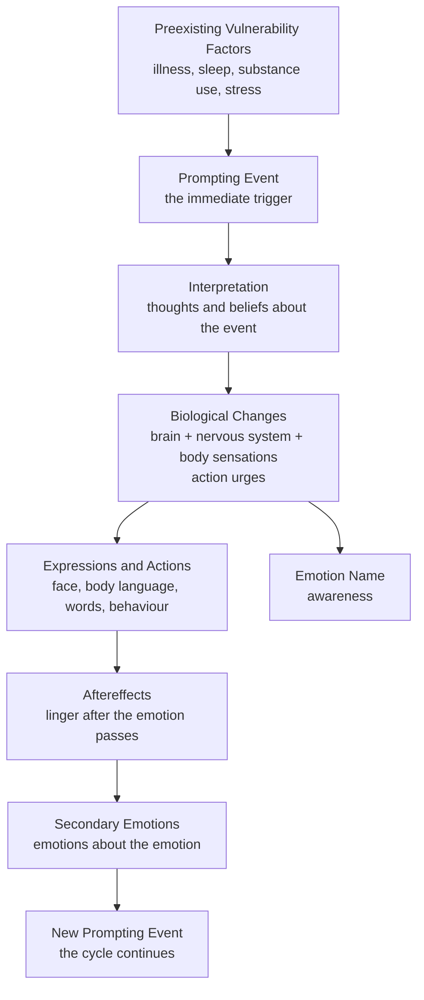

# DBT Integration — Full Analysis and Recommendations
**Date:** 2026-11-04 (updated after correct extraction)
**Source:** DBT Skills Training Handouts and Worksheets (Marsha M. Linehan, 2015)
**Pages extracted:** Printed pages 197–312
**Extracted PDF:** `source/Emotional Regulation Module (DBT).pdf` (116 pages)

---

## Complete module structure — printed pages 197–312

### Section 1: Introduction (printed pp 197–202)
Textbook narrative. Explains the goals, philosophy, and how to use each handout. Key quotes:

> *"The goal of emotion regulation is to reduce emotional suffering. The goal is not to get rid of emotions; emotions have important functions in our lives."*

> *"You have to know what an emotion is and what it does for you before you can effectively regulate it."*

This frames the entire philosophy of the app: **awareness first, regulation second**.

### Section 2: Emotion Regulation Handouts (printed pp 205–268)

| Handout | Printed page | Title | App relevance |
|---|---|---|---|
| 1 | 205 | Goals of Emotion Regulation | Onboarding / what the app is for |
| 2 | 209 | Overview: Understanding and Naming Emotions | Level selector framing |
| 3 | 210 | What Emotions Do for You | Definition panel — "why you feel this" |
| 4 | 211 | What Makes It Hard to Regulate Emotions | Troubleshooting / self-compassion prompt |
| 4a | 212 | Myths about Emotions | 21 myth-busters — gamified for advanced level |
| 5 | 213 | Model for Describing Emotions (diagram) | The 6-dimension model — drives the data schema |
| 6 | 214–223 | Ways to Describe Emotions (10 emotions × 6 dims) | Core data — all emotion dimensions |
| 7 | 227 | Overview: Changing Emotional Responses | Post-selection flow framing |
| 8 | 228 | Check the Facts | Reflection step — built into every session |
| 8a | 229 | Examples of Emotions That Fit the Facts | Justified/unjustified data per emotion |
| 9 | 230 | Opposite Action vs Problem Solving — which to use | Decision flowchart in the app |
| 10 | 231 | Opposite Action (how-to steps) | Coping guidance — advanced |
| 11 | 232–240 | Figuring Out Opposite Actions (per emotion) | Per-emotion coping suggestions |
| 12 | (ref only) | Problem Solving | Future coaching feature |
| 13 | 242–244 | Reviewing Opposite Action and Problem Solving | Summary table — justified events + both options |
| 14 | (ref only) | Overview: Reducing Vulnerability | ABC PLEASE framing |
| 15 | 247 | Accumulating Positive Emotions: Short Term | "One thing to do today" post-session prompt |
| 16 | 248–251 | Pleasant Events List (210 items) | Coping suggestion pool |
| 17 | 252 | Accumulating Positive Emotions: Long Term | Values-based life building — advanced/subscription |
| 18 | 253–255 | Values and Priorities List (58 values, 14 categories) | Values reflection — subscription coaching |
| 19 | 256 | Build Mastery and Cope Ahead | Advanced coaching — preparing for next time |
| 20 | 257 | PLEASE Skills (body-level regulation) | Body-level coping — adult/advanced |
| 21 | (ref only) | Overview: Managing Really Difficult Emotions | Crisis tier framing |
| 22 | 264 | Mindfulness of Current Emotions | "Surfing the wave" — intense emotion pathway |
| 23 | 265 | Managing Extreme Emotions | Crisis pathway — intensity 8–10 |
| 24 | 266–267 | Troubleshooting Emotion Regulation Skills | Self-diagnostic — "why isn't this working?" |
| 25 | 268 | Review of All Skills | Visual skills map in-app |

### Section 3: Emotion Regulation Worksheets (printed pp 271–312)
Fillable worksheets that mirror the handouts. These map directly to the interactive features of the app — the app **is** the digital version of these worksheets.

| Worksheet | Title | App feature |
|---|---|---|
| 1 | Pros and Cons of Changing Emotions | Reflection prompt on session start |
| 2 / 2a–c | Figuring Out What My Emotions Are Doing / Emotion Diary | Session recording + emotion diary |
| 3 | Myths about Emotions | Myth-buster feature (advanced) |
| 4 / 4a | Observing and Describing Emotions | The wheel itself + definition panel |
| 5 | Checking the Facts | Check the Facts step post-selection |
| 6 | Figuring Out How to Change Unwanted Emotions | Flowchart: opposite action vs problem solving |
| 7 | Opposite Action Practice | Coping commitment screen |
| 8 | Problem Solving to Change Emotions | Problem solving flow (future) |
| 9 | Steps for Reducing Vulnerability | ABC PLEASE tracker |
| 10 | Pleasant Events Diary | Post-session pleasant event log |
| 11 / 11a / 11b | Values to Action Steps / Daily Diary | Values tracker — subscription |
| 12 | Build Mastery and Cope Ahead | Mastery planner |
| 13 | Putting ABC Skills Together Day by Day | Daily practice summary |
| 14 | Practicing PLEASE Skills | Body care tracker |
| 15 | Mindfulness of Current Emotions | Guided mindfulness on intense emotions |
| 16 | Troubleshooting | Self-diagnostic tool |

---

## The core model — Handout 5 (printed p213)

This is the theoretical backbone. Every emotion is a **system** with interconnected parts:



**Why this matters for the app:**
- The wheel currently captures only the **Emotion Name** node
- DBT lets us capture: Prompting Event (incident mode), Interpretation (Check the Facts), Biological Changes (body tab), Expressions (awareness tab), Aftereffects (lingering awareness), and Secondary Emotions (did a secondary emotion arise?)
- This makes the app a genuine emotional regulation tool, not just a label picker

---

## The 10 DBT emotions — complete vocabulary

| Emotion | Synonyms and related words |
|---|---|
| Anger | anger, bitterness, fury, indignation, vengefulness, aggravation, exasperation, grouchiness, irritation, wrath, agitation, ferocity, grumpiness, outrage, annoyance, frustration, hostility, rage |
| Disgust | disgust, aversion, dislike, distaste, repugnance, resentment, sickened, abhorrence, condescension, derision, hate, repelled, revolted, spite, antipathy, contempt, disdain, loathing, repulsion, scorn, vile |
| Envy | envy, craving, displeased, greed, pettiness, bitterness, discontented, dissatisfied, green-eyed, resentment, covetous, disgruntled, down-hearted, longing, wishful |
| Fear | fear, dread, horror, nervousness, shock, uneasiness, anxiety, edginess, hysteria, overwhelmed, tenseness, worry, apprehension, fright, jumpiness, panic, terror |
| Happiness | happiness, satisfaction, joviality, exhilaration, ecstasy, joy, bliss, triumph, optimism, gladness, enjoyment, enthusiasm, contentment, zest, pride, relief, jolliness, excitement, eagerness, elation, amusement, thrill, jubilation, gaiety, glee, enthrallment, cheerfulness, zaniness, pleasure, rapture, hope, euphoria, delight, zeal |
| Jealousy | jealous, clutching, fear of losing someone/something, rivalrous, wary, cautious, defensive, suspicious, watchful, clinging, mistrustful, possessive, self-protective |
| Love | love, attraction, enchantment, limerence, sympathy, adoration, caring, fondness, longing, tenderness, affection, charmed, infatuation, lust, warmth, arousal, compassion, kindness, passion, desire, liking, sentimentality |
| Sadness | sadness, disappointment, pity, crushed, disconnected, depression, despair, homesickness, anguish, displeasure, suffering, glumness, grief, neglect, dismay, insecurity, dejection, melancholy, misery, alienation, hurt, sorrow, gloom, alone, agony, discontentment, rejection, defeat, loneliness, woe, distraught, unhappiness |
| Shame | shame, culpability, embarrassment, mortification, shyness, contrition, discomposure, humiliation, self-conscious |
| Guilt | guilt, culpability, remorse, apologetic, regret, sorry |

**Additional emotion words** (from page 223 "Other Important Emotion Words"):
- Weariness, dissatisfaction, disinclination, distress
- Shyness, fragility, reserve, bashfulness, coyness, reticence
- Cautiousness, reluctance, suspiciousness, caginess, wariness
- Surprise, amazement, astonishment, awe, startle, wonder
- Boldness, bravery, courage, determination
- Powerfulness, sense of competence, capability, mastery
- Dubiousness, skepticism, doubtfulness
- Apathy, boredom, dullness, ennui, fidgetiness, impatience, indifference, listlessness

---

## The 6-dimension structure per emotion (from Handout 5 + 6)

Every emotion has 6 dimensions. Below is the complete data extracted for each.

### ANGER
**Prompting events:** Goal blocked. Attacked or threatened. Loss of power/status/respect. Things not as expected. Physical or emotional pain.
**Interpretations:** Treated unfairly. Blaming. Goals being blocked. Things "should" be different. Rigidly "I'm right." Situation judged illegitimate. Ruminating on the event.
**Biological changes:** Muscles tightening. Teeth clamping. Hands clenching. Face flushing. Feeling explosive. Can't stop tears. Wanting to hit/throw/blow up. Wanting to hurt someone.
**Expressions/Actions:** Physically or verbally attacking. Threatening gestures. Pounding/throwing/breaking. Stomping/slamming. Walking out. Loud/quarrelsome/sarcastic voice. Swearing. Criticising. Clenching fists. Frowning. Brooding/withdrawing. Crying. Red/flushed face.
**Aftereffects:** Narrowing of attention. Attending only to the anger-causing situation. Ruminating about the situation or past situations. Imagining future angry situations. Depersonalisation/numbness.
**Opposite action (Handout 11):** Gently avoid instead of attack. Take a time out. Be kind. Imagine empathy for the other person. Unclench hands (willing hands). Relax face and chest. Paced breathing or vigorous exercise.

### DISGUST
**Prompting events:** Seeing/smelling waste. Dirty/slimy contact. Being forced to swallow something unwanted. Near a dead body. Touching items of strangers/disliked people. Witnessing someone grovelling or stripped of dignity. Seeing blood. Extreme hypocrisy. Betrayal, child abuse, racism, cruelty. Something violating Wise Mind values. Unwanted sexual contact.
**Interpretations:** Believing something toxic is being swallowed. Skin/mind being contaminated. Own body parts are ugly. Others are evil or scum. Moral disapproval of self or others. Person is deeply immoral or has violated the natural order.
**Biological changes:** Nausea. Urge to vomit/gag/choke. Lump in throat. Aversion to eating/drinking. Intense urge to destroy or get rid of something. Urge to shower. Urge to run away. Feeling contaminated/dirty. Feeling mentally polluted. Fainting.
**Expressions/Actions:** Vomiting, spitting. Closing eyes, looking away. Washing/scrubbing. Changing clothes. Avoiding food/drink. Pushing/kicking away. Treating with disdain. Attacking. Swearing. Frowning. Sarcastic voice. Nose and lip tightening; smirking.
**Aftereffects:** Narrowing of attention. Ruminating about the disgusting situation. Hypersensitivity to dirt.
**Opposite action (Handout 11):** Move close. Embrace. Be kind. Step into the other person's shoes. Take in what feels repulsive.

### ENVY
**Prompting events:** Someone has something you want but don't have. Not part of the "in" crowd. Someone appears to have everything. Alone while others have fun. Someone gets credit for your work. Competing with someone more successful.
**Interpretations:** Thinking you deserve what others have. Thinking life has been unfair to you. Thinking you are inferior or a failure. Comparing yourself unfavourably to others. Thinking you are unappreciated.
**Biological changes:** Muscles tightening. Teeth clamping. Face flushing. Body rigidity. Pain in stomach pit. Urge to get even. Hating the other person. Wanting others to fail. Feeling pleasure at others' failures.
**Expressions/Actions:** Doing everything to get what the other has. Working harder. Trying to improve yourself. Ruining what the other person has. Attacking or criticising. Getting even. Saying mean things. Avoiding people who have what you want.
**Aftereffects:** Attending only to what others have that you don't. Ruminating about others having more. Discounting what you do have. Ruminating about what you don't have. Making resolutions to change.
**Opposite action (Handout 11):** Inhibit destroying others' things. Count your blessings. Imagine how it all makes sense. Stop exaggerating others' worth.

### FEAR
**Prompting events:** Life/health/wellbeing threatened. Similar situation to past threat. Flashbacks. Seen others threatened. Silence. New/unfamiliar situation. Being alone. Being in the dark. Crowds. Leaving home. Performing in front of others. Pursuing dreams.
**Interpretations:** Believing you might die or be hurt. Might lose something valuable. Someone might reject/criticise you. You'll embarrass yourself. Failure is possible. Won't get help needed. Might lose someone important. Feeling helpless or incompetent.
**Biological changes:** Breathlessness. Fast heartbeat. Choking sensation. Muscles tensing/cramping. Clenching teeth. Urge to scream. Nausea. Cold/clammy. Hairs standing on end. Butterflies in stomach. Wanting to run/avoid.
**Expressions/Actions:** Fleeing. Running/walking hurriedly. Hiding/avoiding. Nervous/fearful talk. Pleading for help. Becoming speechless. Screaming. Darting eyes. Frozen stare. Talking yourself out of doing the feared thing. Freezing. Crying/whimpering. Shaking/trembling. Sweating. Diarrhoea/vomiting.
**Aftereffects:** Narrowing of attention. Hypervigilance to threat. Losing ability to focus. Losing control. Imagining more loss or failure. Isolating. Ruminating about other threatening times.
**Opposite action (Handout 11):** Do what you are afraid of doing, over and over. Approach what you fear. Keep eyes and ears open on the feared event. Take in information (notice you are safe). Confident posture. Paced breathing.

### HAPPINESS
**Prompting events:** Wonderful surprise. Reality exceeding expectations. Getting what you want. Something you worked hard for. Being successful. Receiving esteem/respect/praise. Receiving love/liking/affection. Being accepted. Belonging somewhere. Pleasurable sensations.
**Interpretations:** Interpreting joyful events just as they are, without adding or subtracting.
**Biological changes:** Feeling excited. Physically energetic. Urge to giggle/laugh. Face flushing. Feeling calm all the way through. Urge to keep doing what is associated with happiness. Feeling at peace. Feeling open/expansive.
**Expressions/Actions:** Smiling. Bright/glowing face. Bouncy/bubbly. Communicating good feelings. Sharing. Silliness. Hugging. Jumping up and down. Saying positive things. Enthusiastic voice. Talkative.
**Aftereffects:** Courteous/friendly to others. Doing nice things for others. Positive outlook. High threshold for worry or annoyance. Remembering and imagining other joyful times. Expecting joy in future.

### JEALOUSY
**Prompting events:** Important relationship threatened or in danger of being lost. Competitor pays attention to someone you love. Someone threatening to take important things from your life. Partner flirting. Finding partner is having an affair.
**Interpretations:** Partner doesn't care any more. You are nothing to your partner. Partner is going to leave you. You don't measure up. You were cheated. No one cares about you.
**Biological changes:** Breathlessness. Fast heartbeat. Choking sensation. Muscles tensing. Teeth clenching. Becoming suspicious. Injured pride. Feelings of rejection. Needing to be in control. Feeling helpless. Wanting to grasp/hold. Wanting to push away/eliminate rival.
**Expressions/Actions:** Violent behaviour or threats toward the person threatening to take something away. Attempting to control the other person's freedom. Verbal accusations. Spying. Interrogating. Collecting evidence. Clinging. Excessive demonstrations of love.
**Aftereffects:** Narrowing of attention. Seeing the worst in others. Being mistrustful across the board. Hypervigilance to threats to relationships. Becoming isolated.
**Opposite action (Handout 11):** Let go of trying to control others. Share what you have. Stop spying and snooping. Take in all the information.

### LOVE
**Prompting events:** Someone offers/gives you something you want or need. Does things you value or admire. Physical attraction. Being with someone fun. Spending a lot of time with a person. Sharing a special experience. Exceptionally good communication.
**Interpretations:** Believing a person loves, needs, or appreciates you. Thinking a person is physically attractive. Judging a person's personality as wonderful or pleasing. Believing a person can be counted on.
**Biological changes:** Feeling excited and full of energy. Fast heartbeat. Feeling self-confident. Feeling invulnerable. Feeling happy/joyful/exuberant. Feeling warm, trusting, secure. Feeling relaxed and calm. Wanting the best for a person. Wanting to give things to a person. Wanting physical/emotional closeness.
**Expressions/Actions:** Saying "I love you." Expressing positive feelings. Eye contact, mutual gaze. Touching, petting, hugging, holding, cuddling. Sexual activity. Smiling. Sharing time and experiences.
**Aftereffects:** Only seeing a person's positive side. Feeling forgetful or distracted; daydreaming. Feeling openness and trust. Feeling "alive" and capable. Remembering other loved ones. Believing in yourself.

### SADNESS
**Prompting events:** Losing something or someone irretrievably. Death of someone you love. Things not as expected or wanted. Being separated from someone you care for. Not getting what you worked for. Being rejected or excluded. Feeling powerless/helpless. Being with someone sad or in pain. Being alone or feeling like an outsider.
**Interpretations:** Believing a separation will last forever. Believing you will not get what you want or need. Seeing things as hopeless. Believing you are worthless or not valuable.
**Biological changes:** Feeling tired/run down/low energy. Feeling lethargic, listless. Nothing feels pleasurable. Pain or hollowness in chest or gut. Feeling empty. Feeling unable to stop crying. Difficulty swallowing. Breathlessness. Dizziness.
**Expressions/Actions:** Avoiding things. Acting helpless, staying in bed, inactive. Moping, brooding. Slow shuffling movements. Withdrawing from social contact. Avoiding activities that used to bring pleasure. Giving up. Saying sad things. Quiet/slow/monotonous voice. Eyes drooping. Frowning. Posture slumping. Sobbing/crying/whimpering.
**Aftereffects:** Unable to remember happy things. Feeling irritable/touchy/grouchy. Yearning and searching for what was lost. Negative outlook. Blaming/criticising yourself. Ruminating about sad past events. Insomnia. Appetite disturbance.
**Opposite action (Handout 11):** Activate your behaviour. Avoid avoiding. Build mastery.

### SHAME
**Prompting events:** Being rejected by people you care about. Others finding out you did something wrong. Doing something people you admire believe is wrong or immoral. Comparing yourself to a standard and falling short. Being betrayed. Being laughed at or made fun of. Being criticised publicly. Being reminded of past wrongdoing. Exposure of a private aspect of yourself.
**Interpretations:** Believing others will reject you. Judging yourself inferior or "not good enough." Believing yourself unlovable. Thinking you are bad, immoral, or wrong. Thinking you are defective. Thinking your body is ugly. Thinking your behaviour, thoughts, or feelings are silly or stupid.
**Biological changes:** Pain in stomach pit. Sense of dread. Wanting to shrink down and disappear. Wanting to hide or cover face and body.
**Expressions/Actions:** Hiding behaviour or characteristics. Avoiding the person you harmed. Avoiding people who criticised you. Avoiding yourself — distracting, ignoring. Withdrawing; covering face. Bowing head, grovelling. Appeasing; saying sorry over and over. Looking down and away. Sinking back; slumped and rigid posture. Halting speech; lowered volume.
**Aftereffects:** Avoiding thinking about the transgression; shutting down; blocking all emotions. Engaging in distracting, impulsive behaviours. High amount of self-focus; preoccupation. Depersonalisation/numbness. Attacking or blaming others. Conflicts with others. Isolation/alienation. Impaired problem-solving ability.
**Opposite action (Handout 11):** Make public your personal characteristics or behaviour (with people who won't reject you). Repeat the behaviour without hiding. Or, if moral code is violated: apologise, repair, forgive yourself, let it go.

### GUILT
**Prompting events:** Doing or thinking something you believe is wrong. Violating your personal values. Not doing something you said you would. Committing a transgression against another person. Causing harm. Being reminded of past wrongdoing.
**Interpretations:** Thinking your actions are to blame for something. Thinking you behaved badly. Thinking "if only I had done something differently."
**Biological changes:** Hot, red face. Jitteriness, nervousness. Suffocating.
**Expressions/Actions:** Trying to repair the harm, make amends, fix the damage. Asking for forgiveness, apologising, confessing. Giving gifts/making sacrifices. Bowing head, kneeling.
**Aftereffects:** Making resolutions to change. Making changes in behaviour. Joining self-help programmes.
**Opposite action (Handout 11):** Do what makes you feel guilty over and over (for unjustified guilt). Make public your behaviour (with safe people). Or if moral code is violated: seek forgiveness, repair the harm, accept consequences gracefully, commit to change.

---

## Key concepts for the app (from pages 197–213)

### What Emotions Do for You (Handout 3)
Three functions — surfaces naturally in the definition panel as "Why you feel this":
1. **Motivate and organise us for action** — emotions prepare us for action and help us overcome obstacles
2. **Communicate to others** — facial expressions, body language, and voice tone communicate faster than words
3. **Communicate to ourselves** — gut feelings are signals that something important is happening

### What Makes Regulation Hard (Handout 4)
Six barriers — useful as a self-compassion prompt when the user says "why isn't this working":
1. Biology
2. Lack of skill
3. Environment reinforces emotional behaviour
4. Moodiness (current mood overrides Wise Mind)
5. Emotional overload (skills breakdown point)
6. Emotion myths

### Myths about Emotions (Handout 4a)
21 myths to challenge. These are excellent **gamified content** for the advanced level — e.g. a daily "myth check" feature, or displayed when a user seems stuck in a pattern:
- "There is a right way to feel in every situation"
- "Being emotional means being out of control"
- "My emotions are who I am"
- "Emotional truth is what counts, not factual truth"
- "Emotions should always be trusted"

---

## Data model — confirmed additions

### `emotion_dimensions` (normalised — one row per bullet point)

```sql
CREATE TABLE emotion_dimensions (
  id            UUID         NOT NULL DEFAULT (UUID()) PRIMARY KEY,
  emotion_key   VARCHAR(100) NOT NULL,
  dimension     ENUM(
                  'synonyms',
                  'prompting_event',
                  'interpretation',
                  'biological_change',
                  'expression_action',
                  'aftereffect',
                  'opposite_action',
                  'justified_when',
                  'coping_strategy',
                  'child_language',
                  'what_it_does'
                ) NOT NULL,
  content       TEXT NOT NULL,
  level_min     ENUM('child','adult','advanced') NOT NULL DEFAULT 'adult',
  source        VARCHAR(100) NOT NULL,
  display_order SMALLINT     NOT NULL DEFAULT 0,
  FOREIGN KEY (emotion_key) REFERENCES emotions(key)
);
```

### `emotion_myths` (new — Handout 4a data)

```sql
CREATE TABLE emotion_myths (
  id            UUID         NOT NULL DEFAULT (UUID()) PRIMARY KEY,
  myth_text     TEXT         NOT NULL,
  challenge     TEXT         NULL,   -- can be authored later
  display_order SMALLINT     NOT NULL DEFAULT 0,
  source        VARCHAR(100) NOT NULL DEFAULT 'dbt-handout-4a'
);
```

### `coping_suggestions` (confirmed)
Draws from Handouts 10, 11, 15, 16, 19, 20, 22.

### `session_reflections` (confirmed)
Captures Check the Facts flow (Handout 8), intensity before/after, action urge, opposite action commitment, reframe.

---

## Feature-to-phase mapping (updated)

| Feature | DBT source | Phase |
|---|---|---|
| Emotion definitions with 6 DBT dimensions | Handout 6 | Phase 1 (data) |
| "Why you feel this" section in definition panel | Handout 3 | Phase 1 |
| Body sensations tab | Handout 6 biological changes | Phase 1 |
| Prompting events tab | Handout 6 prompting events | Phase 1 |
| Intensity slider on emotion selection | — | Phase 1 |
| "Check the Facts" post-selection reflection | Handout 8 | Phase 1/2 |
| Coping suggestions (child: breathing; adult: PLEASE; advanced: opposite action) | Handouts 10/11/20 | Phase 2 |
| Pleasant Events post-session suggestion | Handout 16 (210 items) | Phase 2 |
| Myths about Emotions daily feature (advanced) | Handout 4a | Phase 2 |
| Crisis pathway for high intensity | Handout 23 | Phase 2 |
| "What makes regulation hard" self-compassion prompt | Handout 4 | Phase 2 |
| Coaching flow: full opposite action + reframe | Handouts 10/11/13 | Phase 3 (subscription) |
| Values reflection | Handout 18 | Phase 3 (subscription) |
| Build Mastery + Cope Ahead | Handout 19 | Phase 3 (subscription) |
| Sleep hygiene protocol | Handout 20b | Phase 3 (subscription) |
| AI-assisted reframe suggestions | Handout 8 + embeddings | Phase 5 |
| Emotion Diary (longitudinal) | Worksheet 2b | Phase 2/3 |
| ABC PLEASE tracker | Worksheet 9/13 | Phase 3 |
